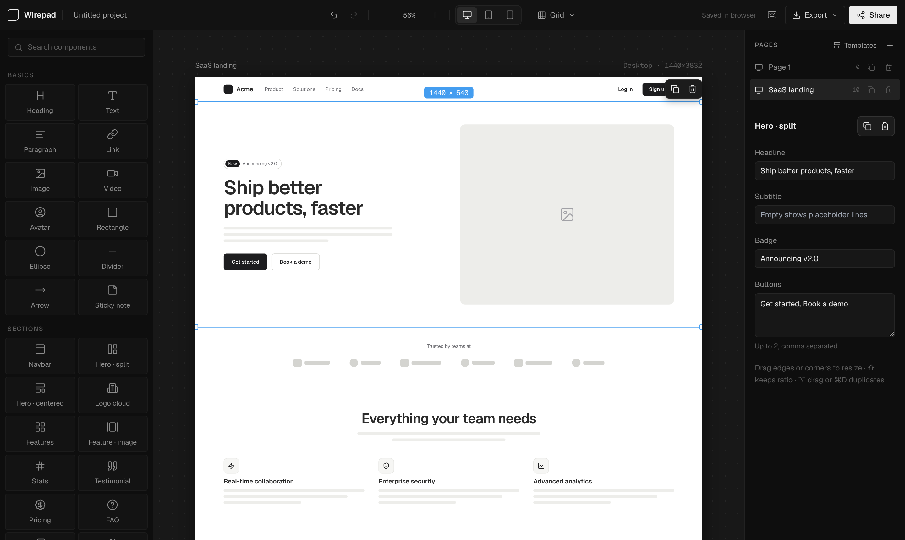

# Wirepad

A fast, minimal wireframing tool for the browser. Drag ready-made components onto desktop, tablet or mobile pages, then export images or share a link. There are no accounts or servers: your work is saved in your browser.

**Live:** [wirepad.ridv.art](https://wirepad.ridv.art)



## Features

- **100+ ready-made components:** basics, full-width web sections (hero, features, pricing, FAQ, testimonials, footer…), app UI (sidebar, top bar, tables, settings rows), mobile UI (status bar, large title, cells, tab bar, sheets, chat), forms, data and charts, overlays, and icons. The library only shows what fits the current device.
- **Artboards:** Desktop (1440×1024), Tablet (834×1194) and Mobile (390×844). Drag the handle under the page to make it taller.
- **Responsive adapt:** switching a page to another device re-lays out its content, for example turning a sidebar into a tab bar and a table into a list on mobile. One <kbd>⌘</kbd> <kbd>Z</kbd> undoes it.
- **Fast editing:**
  - drag from the library or click to add;
  - move and resize from large edge and corner handles, with alignment guides that snap to the page and to other elements;
  - type an exact width or height in the size badge on the selection;
  - <kbd>⇧</kbd> keeps proportions while resizing;
  - select several elements by dragging a box on empty canvas, <kbd>⇧</kbd>-clicking, or <kbd>⌘</kbd> <kbd>A</kbd>, then move, duplicate or delete them together;
  - edit each component's own content (headlines, menu items, toggles) in the inspector;
  - <kbd>⌘/Ctrl</kbd>+<kbd>D</kbd> duplicates (and repeats the last offset), <kbd>⌥/Alt</kbd>-drag duplicates while dragging;
  - copy, cut, paste, arrow-key nudge, and undo/redo.
- **Grid:** 8 / 16 / 32 px, picked from the top bar or cycled with <kbd>G</kbd>.
- **Pages and templates:** multiple pages per project, renamed inline. 23 templates across desktop (SaaS landing, pricing, blog, dashboard, CRM, settings, sign in, product page…), tablet and mobile (onboarding, feed, shop, cart, profile, messages, chat…).
- **Export:** PNG, PNG @2x, JPG, or every page at once, named after the page. Projects can be saved and loaded as `.json` files.
- **Share links:** a view-only link carries the whole project, compressed into the URL. Nothing is uploaded. Viewers can flip through pages, export images, or make an editable copy.
- **Autosave:** everything is saved to your browser's local storage as you work.

## Keyboard shortcuts

| Action | Shortcut |
| --- | --- |
| Undo / Redo | <kbd>⌘</kbd> <kbd>Z</kbd> / <kbd>⌘</kbd> <kbd>⇧</kbd> <kbd>Z</kbd> |
| Duplicate | <kbd>⌘</kbd> <kbd>D</kbd> |
| Duplicate while dragging | <kbd>⌥</kbd> drag |
| Copy / Cut / Paste | <kbd>⌘</kbd> <kbd>C</kbd> / <kbd>⌘</kbd> <kbd>X</kbd> / <kbd>⌘</kbd> <kbd>V</kbd> |
| Box select | Drag on empty canvas |
| Add to selection | <kbd>⇧</kbd> click |
| Select all | <kbd>⌘</kbd> <kbd>A</kbd> |
| Delete | <kbd>⌫</kbd> |
| Nudge (×10 with Shift) | Arrow keys |
| Bring forward / Send backward | <kbd>]</kbd> / <kbd>[</kbd> |
| Cycle grid 8 / 16 / 32 / off | <kbd>G</kbd> |
| New blank page | <kbd>P</kbd> |
| Templates | <kbd>T</kbd> |
| Zoom in / out / fit | <kbd>⌘</kbd> <kbd>+</kbd> / <kbd>⌘</kbd> <kbd>−</kbd> / <kbd>⌘</kbd> <kbd>0</kbd> |
| Export PNG | <kbd>⌘</kbd> <kbd>E</kbd> |
| Deselect / close | <kbd>Esc</kbd> |
| All shortcuts | <kbd>?</kbd> |

On Windows and Linux, use <kbd>Ctrl</kbd> for <kbd>⌘</kbd> and <kbd>Alt</kbd> for <kbd>⌥</kbd>.

## Getting started

Requires Node.js 20.9+ and [pnpm](https://pnpm.io).

```bash
pnpm install
pnpm dev
```

Then open [http://localhost:3000](http://localhost:3000). For a production build, run `pnpm build && pnpm start`.

## Project structure

```
app/                         Next.js app shell, fonts (Geist) and global styles
components/wirepad/
  editor.tsx                 Layout, keyboard shortcuts, global pointer handling
  toolbar.tsx                Top bar: undo, zoom, artboard, grid, export, share
  sidebar.tsx                Component library with search
  canvas.tsx                 Artboard, selection handles, guides, grid overlay
  canvas-element.tsx         Binds the component renderers to React and Lucide
  screen-manager.tsx         Pages list and properties inspector
  modals.tsx                 Templates, share link and shortcuts dialogs
lib/
  wirepad-lib.js (+ .d.ts)   Component renderers, library, inspector fields, templates, responsive adapt
  component-registry.ts      Typed access to the library and project types
  store.ts                   Zustand store: project state, undo/redo, autosave
  interactions.ts            Move, resize, smart guides, multi-select, page height, library drag-and-drop
  export.ts                  PNG/JPG/JSON export (html-to-image)
  share.ts                   Encode/decode projects in share links
```

**Built with** Next.js, React, TypeScript, Tailwind CSS, Zustand, html-to-image and Lucide icons.
